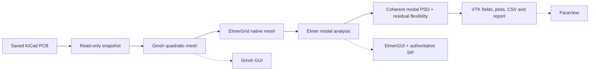

# PCB Mechanical Lab

Portable PCB modal and random-vibration screening with KiCad, Gmsh, Elmer and
ParaView. Linux x86-64 is the initial supported platform. Cases use JSON; original
tooling and documentation use Apache-2.0, matching PCB EM Lab and PCB Thermal Lab.

The workflow reads saved boards without saving, refilling or editing them. It
creates an immutable input snapshot and keeps geometry, meshes, authoritative
Elmer SIFs, eigenmodes, PSD results and provenance in its own output directory.
Board-specific inputs remain separate from reusable tooling.

## Quick start

Use Python 3.11+ and rootless Podman on Ubuntu 24.04. The launcher requires no host
numerical Python packages; numerical stages run in containers.

```bash
./pcb-mechanical bootstrap
./pcb-mechanical build --profile cpu --jobs 2
./pcb-mechanical doctor --backend cpu --full
./pcb-mechanical run examples/cantilever/case.json --backend cpu
```

`bootstrap` installs host prerequisites using sudo. It never replaces the graphics
driver. Builds are outside the simulation time budget and may take substantially
longer than a simulation. Sources and numerical GPU wheels are SHA-256 pinned.

For optional NVIDIA support:

```bash
./pcb-mechanical bootstrap --cuda
./pcb-mechanical build --profile cuda --jobs 2 --cuda-arch 75
./pcb-mechanical doctor --backend cuda --full
./pcb-mechanical run examples/cantilever/case-cuda.json --backend cuda
```

When the matching PCB Thermal Lab images are already installed, an optional local
build shortcut reuses their exact image identities and records the consumed source
hashes. It does not edit the thermal repository or its images:

```bash
./pcb-mechanical build --profile all --reuse-installed --jobs 2
```

Fresh source builds do not require another lab checkout. Completed image identities
and dependency inventories are recorded under `env/locks/`. Use `export` and
`import` to transfer a verified image bundle to another compatible Linux machine.

To expose the command from any directory:

```bash
python3 -m venv --system-site-packages .venv
. .venv/bin/activate
python -m pip install --no-build-isolation -e .
```

## Workflow



Stages are `extract`, `mesh`, `convert`, `modal`, `psd`, `postprocess`, and `all`.
Selecting a stage runs its prerequisites. Reuse requires matching physical inputs,
tooling, images and artifact hashes. `--force` replaces only the selected owned
output stages. GUI launches automatically create an editable copy in `results/gui/`.

CPU uses one Elmer process with CHOLMOD; CUDA uses AMGX for the inner linear solves
of Elmer's real ARPACK iteration. The GPU adapter uses diagonally scaled PCG,
reuses AMGX setup, and applies a residual-refinement correction against the
physical stiffness matrix. Both backends use consistent FEM mass matrices and
the same stress recovery. CUDA PSD calculations use CuPy in double precision. Geometry,
assembly, outer eigenvalue iteration and rendering remain on CPU. GPU use is not
a promise of speedup for small cases.

Explicit CPU never probes NVIDIA. Explicit CUDA fails if unavailable. `auto`
reports its initial choice; a solver failure never triggers a backend switch.
The initial CUDA implementation supports one NVIDIA GPU and one solver process.

## Board studies

Define the physical model in a case JSON, including an explicit mounting kind.
Hole mounts require the footprint references and contact diameter; cantilever
mounts fix the minimum-X end face. Start with the self-contained example:

```bash
./pcb-mechanical study --case examples/cantilever/case.json \
  --backend cpu --time-budget-minutes 60
./pcb-mechanical study --case examples/cantilever/case.json \
  --backend cuda --time-budget-minutes 60
```

For another board, prepare its case and use, for example:

```bash
./pcb-mechanical study --case /path/to/mechanical-case.json \
  --board /path/to/board.kicad_pcb --backend cpu
```

`--board` optionally overrides the board declared in the case. The case retains
its material, component masses, mounting regions, damping and resource limits.
Studies always run the full modal/PSD pipeline. The coarse mesh uses the case's
`mesh.size_mm`; the fine mesh uses two thirds of that spacing (3 mm and 2 mm with
the defaults). A study includes both meshes and their comparison report.

Run backends sequentially. Outputs default to ignored
`results/studies/<board-stem>/<backend>/`; use `--output` to distinguish boards
with the same filename or separate physical cases. The study uses this output
location instead of the case's single-run `output`. Source checkouts and indexes
receive no writes. Mounting assumptions are required per case, with no default
hole references or contact diameter.

The excitation is synthetic: flat 20–2000 Hz, 1 g RMS separately in each axis.
Damping is 2%, with 1% and 5% sensitivities. This is screening, not an environmental
qualification profile. Material and component-mass assumptions are in every report.

A deadline is a limit, not proof of numerical completion. Interrupted, over-budget,
unconverged and insufficient-mode cases remain visibly incomplete. The 6 GiB
memory cap and 2 GiB host-memory reserve protect ongoing desktop work. The
initial mesh limit is 150,000 displacement unknowns and the GPU budget is 4.5 GiB.

## GUI access

```bash
./pcb-mechanical gui gmsh --workdir "$PWD/results/examples/cantilever/cpu/mesh" -- /work/board.msh
./pcb-mechanical gui elmer --workdir "$PWD/results/examples/cantilever/cpu/modal/mesh"
./pcb-mechanical gui paraview --workdir "$PWD/results/examples/cantilever/cpu/postprocess" -- --data=/work/modes.pvd
```

Each GUI command prints the retained working-copy directory. In ElmerGUI, choose **File → Load Project → /work**. The generated project includes
the native mesh and authoritative SIF. **Sif → Generate** replaces custom solver
settings; retain the supplied SIF for reproducible scripted runs. Gmsh can also
open `geometry.brep`. ParaView can open `rms.vtu` or `animation.pvd`; the animation
exaggerates the first mode for display and is not a physical response amplitude.
Authenticated X11/XWayland forwarding follows the other labs. A headless ParaView
script is supplied with each report and saves a native PVSM state. The tools
image can run the CPU SIF interactively. GPU SIFs can be inspected there; execute
their solves through the CUDA CLI workflow. Add `--smoke-test-seconds 10` to a
GUI command to close only that launched application after a short startup check.

See [the example](examples/cantilever/README.md), [case and physics details](docs/cases.md),
and [validation evidence](docs/validation.md).

## Licensing and upstream sources

Original software and documentation are [Apache-2.0](LICENSE); see [NOTICE](NOTICE).
Imported hardware snapshots and physical inputs retain their original licenses
and attribution. Elmer source modifications
retain their original upstream license notices; all third-party applications keep
their own licenses. Installed sources and applied patches remain in the images.

Numerical interfaces follow the [Elmer manuals](https://www.nic.funet.fi/index/elmer/doc/),
[Gmsh documentation](https://gmsh.info/doc/texinfo/), and
[CuPy installation documentation](https://docs.cupy.dev/en/v13.6.0/install.html).
